# Skincare Boutique System

Radiant Glow is a desktop system for running a skincare shop, built with Java Swing. It manages products, customer orders, sales and staff accounts. Data is saved in text files, so no database setup is needed.

Built for IT 203 – Object-Oriented Programming.

Members: Cajutay, Maria Angelica V.
         Cruz, Derone James C. 
         BSIT2AG2

## Setup Instructions

You need JDK 25 and Apache NetBeans.

1. Download or clone this repository.
2. In NetBeans, choose File > Open Project and select the project folder.
3. Run the project. The main class is skincareboutique.Main.

The data folder is created on the first run, with the default accounts and 15 sample products.

## Default Accounts

| Username | Password | Access |
|---|---|---|
| admin | admin123 | Admin |
| staff | staff123 | Staff |

The customers and products in these screenshots are sample data.

---

## Login

Admin and Staff log in here. Only an admin can create new accounts.

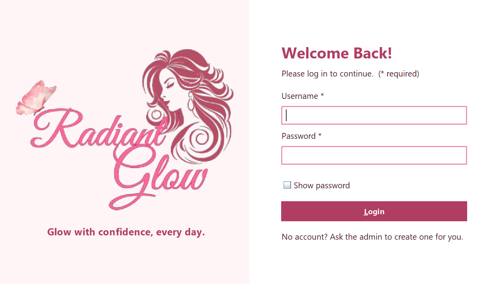

After 3 wrong tries, a Staff account is blocked and the system closes. Only an admin can unblock it.

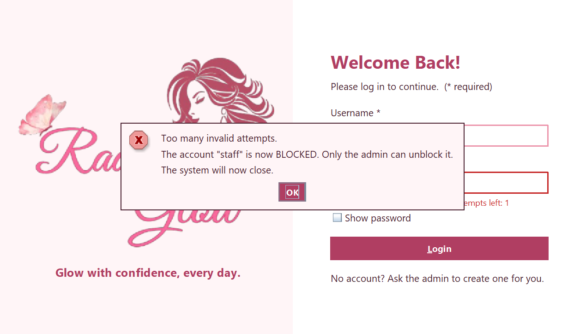

---

## Products

Admins can add, update and delete products. Product IDs are numbered automatically, and required fields turn red if left empty. The line under the table counts low-stock products (5 or less).

Everyone can search by keyword, find a product by ID, and sort by ID, price or name.

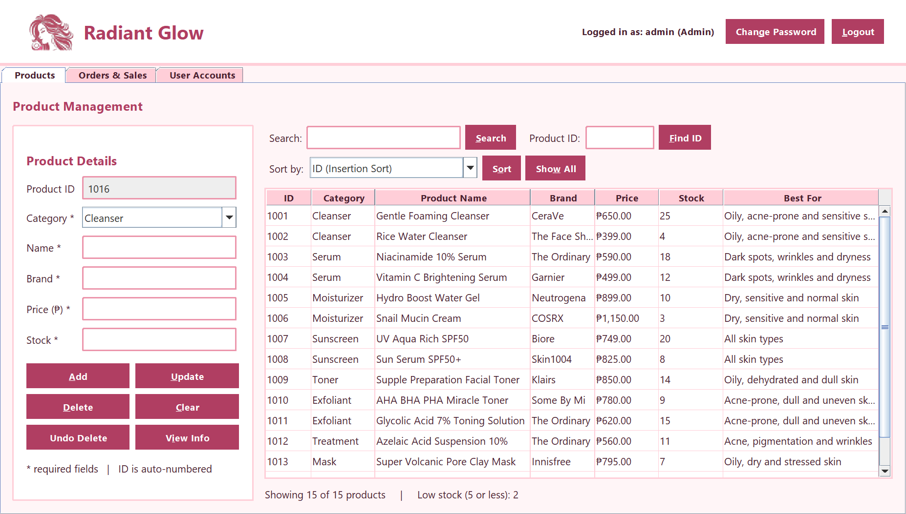

**View Info** shows a product's key ingredients, what it's best for and its benefits.

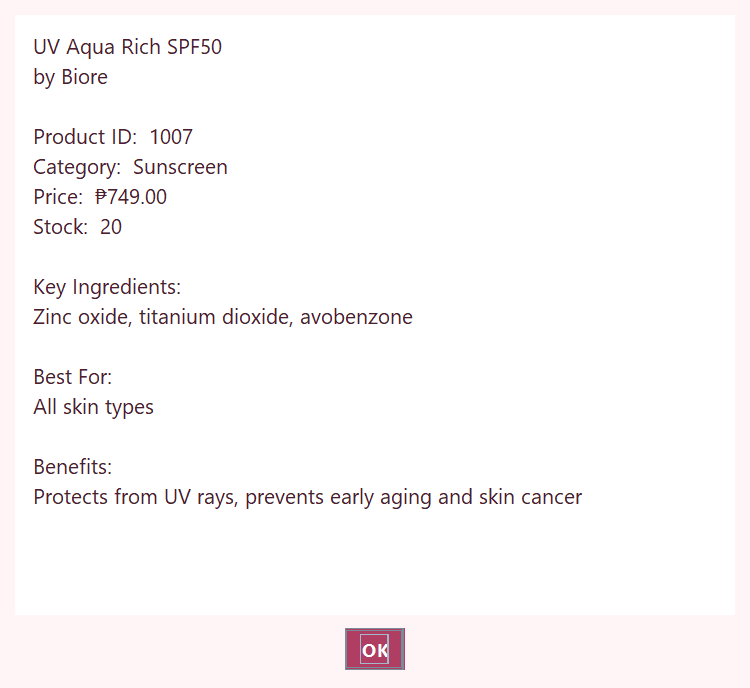

Deleting a product asks for an admin password, and **Undo Delete** can bring it back. The same password check protects deleting users and voiding sales.

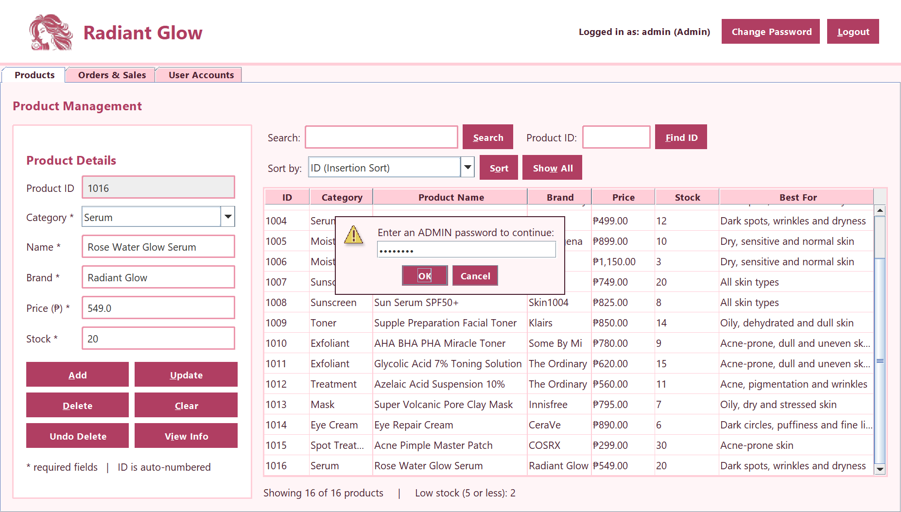

---

## Orders and Sales

One order can hold many products. Buying 3 or more of one sunscreen gives 5% off, and customers can get a Loyalty Card (5%), Student (10%), or Senior Citizen / PWD (20%) discount.

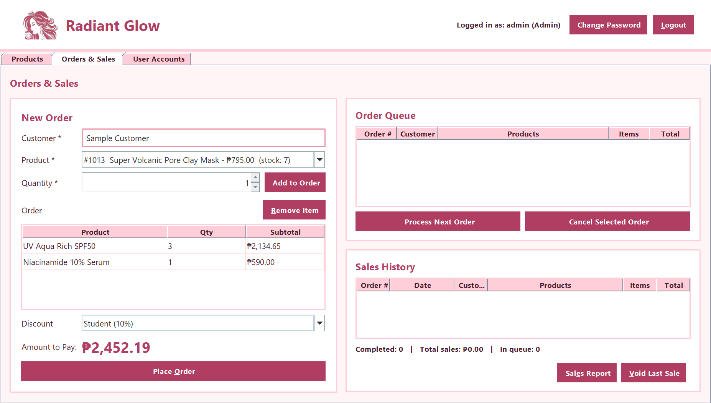

Placed orders wait in a first-come, first-served queue. A wrong order can be cancelled from anywhere in the line.

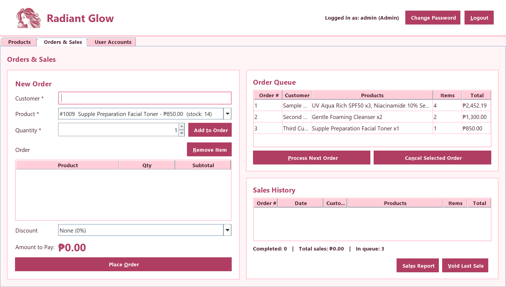

Process Next Order checks the stock of every product, lowers it, and shows a receipt. If a product is short, the whole order is cancelled.

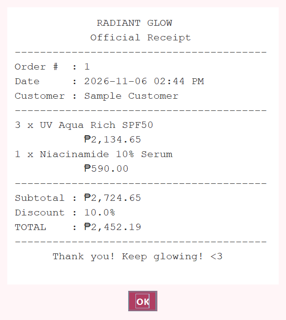

Sales Report shows weekly or monthly totals, the best seller and the list of orders. If a wrong order was already processed, an admin can use Void Last Sale to cancel it and return its stock.

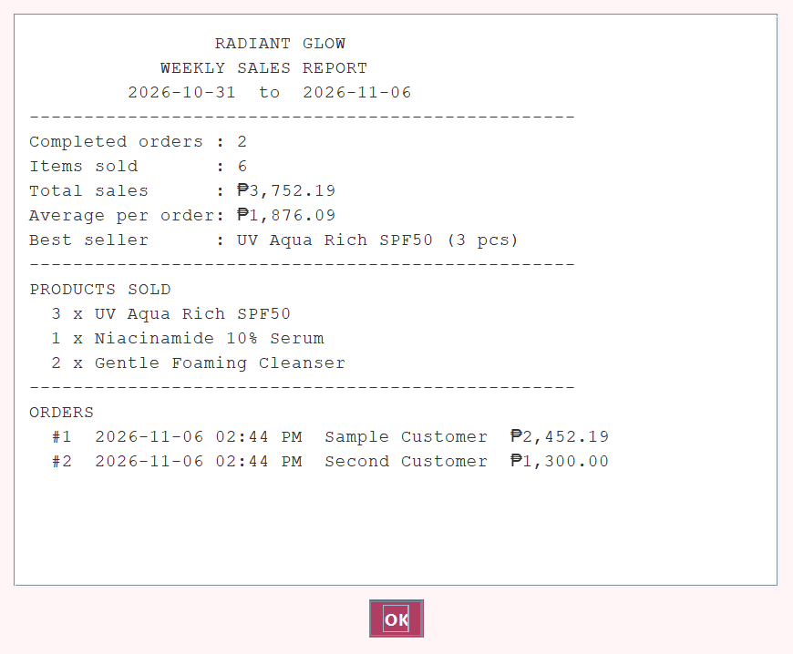

---

## User Accounts

Only admins see this tab. They can add, block, unblock and delete users, but can't block or delete their own account or delete the last admin.

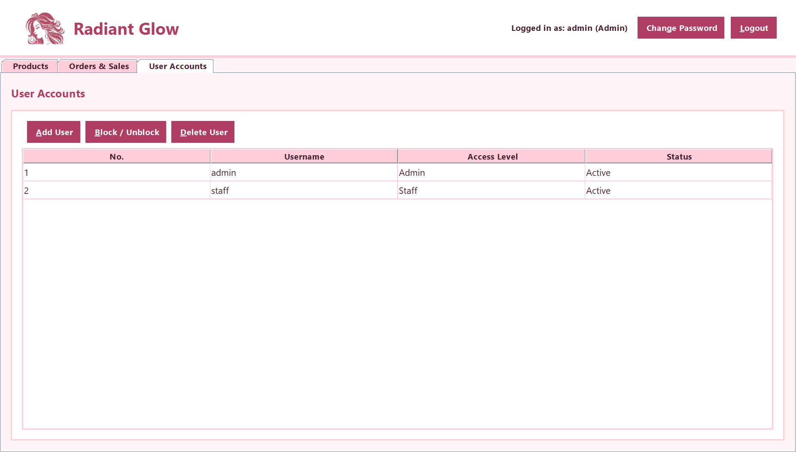

When adding a user, the form shows errors while the admin types. A username needs 4 to 20 letters, numbers or underscores. A password needs at least 6 characters with both letters and numbers.

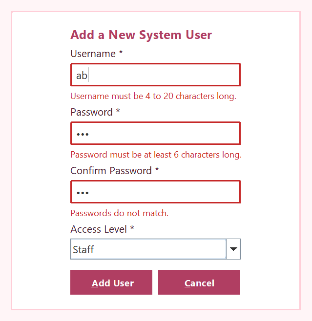

Every user can also change their password and log out using the buttons at the top of the dashboard.

---

## Staff View

Staff can view products and handle orders. The product form, the User Accounts tab and the Void Last Sale button are hidden.

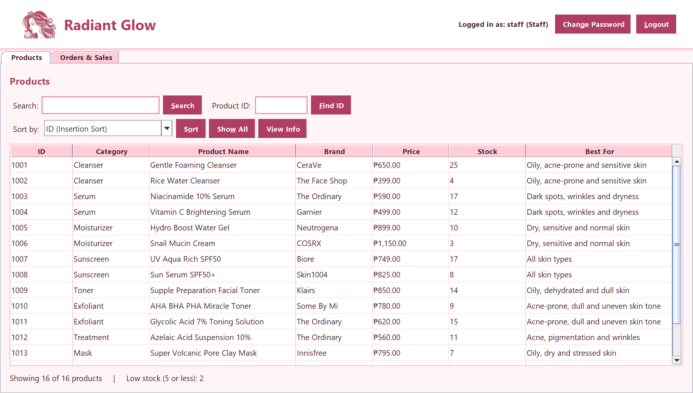

---

## UML Class Diagram

<a href="uml/uml-class-diagram.png">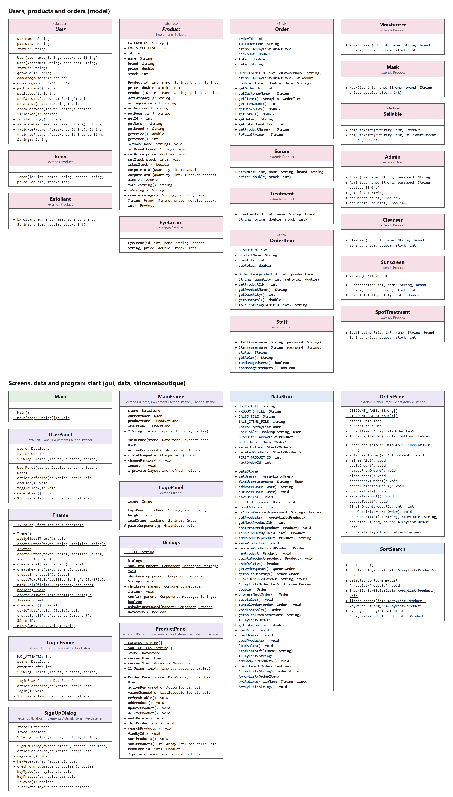</a>

---

## Project Structure

| Package | Contents |
|---|---|
| skincareboutique | Main, where the program starts |
| gui | The login form, dashboard, tabs, dialogs and theme |
| data | DataStore for saving and loading, SortSearch for sorting and searching |
| model | User, Admin, Staff, Product, the 10 product types, Sellable, Order and OrderItem |
